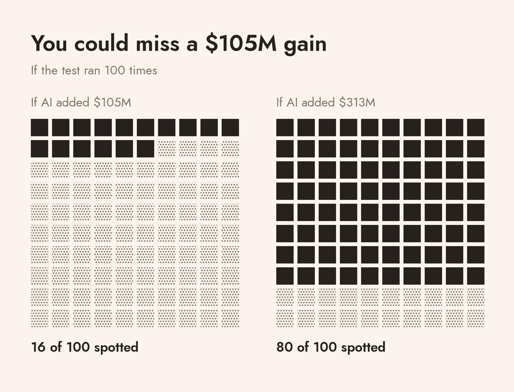
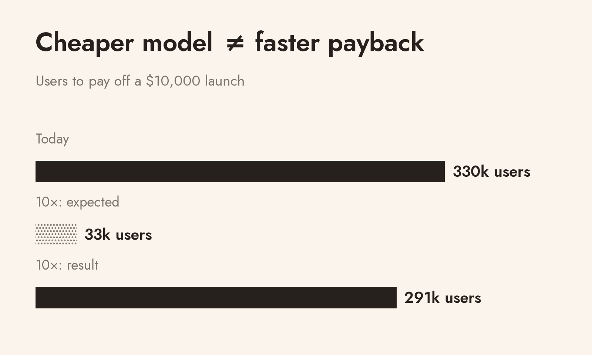

# Has AI made businesses any money?

> Apollo’s chief economist says companies outside tech have seen no financial gains from AI. I did the math: public reports can’t settle this question in either direction.

- **Canonical:** https://wyddy.tech/articles/ai-payoff/
- **Author:** Daniil Makeev (https://wyddy.tech/)
- **Published:** 2026-11-01

[Apollo](https://www.apollo.com/institutional/insights-news/insights/daily-spark/no-signs-of-ai-payoff-outside-the-tech-sector)’s chief economist says companies outside tech have seen no financial gains from AI. His evidence is a set of charts built from public company reports: outside the biggest tech firms, profit margins stay flat. I build AI systems for a living, so I wanted to know whether that is even true. I did the math. Public reports can’t settle this question in either direction. To know, you have to look inside a company.

## A flat line can hide $105 million

A bathroom scale shows a slightly different number every time you step on it. Before you trust it to tell you whether you gained a pound, you check how much it jumps around. I did the same with company accounts.

I took [180 large US companies](https://www.sec.gov/Archives/edgar/data/884394/000175272423046862/NPORT_J905_27092374_1222.htm) [outside tech, finance and real estate](https://www.sec.gov/Archives/edgar/data/1064641/000175272423046851/NPORT_J911_44083836_1222.htm), and compared industries where more of the work is the kind AI can do with the rest. The gain I looked for is those industries pulling ahead of the others by one point of operating margin, say from 10% to 11%. A typical company here had about [$10.5 billion in revenue](https://www.sec.gov/search-filings/edgar-application-programming-interfaces), so for it one point is roughly $105 million a year. For comparison, Klarna says its AI assistant saves it about $58 million a year. Then I looked at how much margins moved on their own in 2015-2019, before generative AI, and asked how often a test on public accounts would spot a one-point gain inside that movement.

*Figure 1. If the same test could be run 100 times on equally noisy data, how often it would spot a gain of $105 million and of $313 million a year. In reality it runs once. 180 companies, accounts for 2015-2019.*

The answer is 16 times out of 100. To be spotted 80 times out of 100, a gain would have to be about $313 million a year. Before collecting any results, I had decided that if the test could not see a one-point gain, I would not run it on the AI years, 2024 and 2025, because a “no effect” from it would mean very little. So I stopped there.

Apollo’s charts are blunter than my test, because they average every company together. If firms with a tenth of all revenue gained one point of margin, the average would move by a tenth of a point.

The test has limits: one sample of 180 companies, [AI exposure](https://arxiv.org/abs/2303.10130) estimated from [the jobs people hold in each industry](https://www.bls.gov/oes/2022/may/oessrci.htm) rather than from observed use, and one pre-AI period.

## The big numbers measure something else

The optimistic numbers fail in a different way. Forrester’s 132-353% ROI is a projection for a modeled company. McKinsey’s 39% (2025) and 37% (2026) of firms reporting an AI contribution to profit are what respondents say about themselves. [BCG](https://www.bcg.com/assets/2025/the-widening-ai-value-gap.pdf) finds that companies further along with AI have better financial results, but comparing leaders with everyone else does not separate what AI earned from everything else those companies did. I checked 33 numbers like these from 17 studies and reports, and none of them shows what was left after all costs, compared with not using AI. The full list is at the end of the full version of this article.

## Where the money goes in one project

To see where the money goes, I took one project. In a large experiment on an international shopping platform, [44,614 users](https://arxiv.org/html/2510.12049v6) got either the usual “support unavailable” reply or an AI chat when they had a question before buying. Per 1,000 users, purchases rose by $274. Note what this compares: an AI chat against no help at all, so it says nothing about replacing a good human service.

Suppose the shop keeps 20% of a sale after product and running costs. Then the $274 becomes about $55. Take away $4.50 for the model and $20 for the rest of the service, and about $30 per 1,000 users is left to pay for the launch. With a $10,000 launch, the project needs about 330,000 users to break even. The 20% margin and the costs are my assumptions, not the shop’s real budget.

Model prices keep falling, and people expect that to fix this math. With [a model ten times cheaper](https://platform.claude.com/docs/en/about-claude/pricing), the project still needs 291,000 users.

*Figure 2. Users needed to pay off a $10,000 launch, assuming a 20% margin, $20 of other cost per 1,000 users, the same sales effect for both models and a steady flow of users. "Expected" is the naive guess that a model ten times cheaper pays off ten times sooner.*

The model was a small part of the bill from the start. And if the real sales effect sits at the low end of the experiment’s range, about $84 per 1,000 users, the project loses money with either model.

## Klarna’s savings

Klarna is the best-known public case. In February 2024 it [forecast a $40 million annual profit improvement](https://www.prnewswire.com/news-releases/klarna-ai-assistant-handles-two-thirds-of-customer-service-chats-in-its-first-month-302072744.html) from its AI assistant. In May 2025 its CEO [told Bloomberg](https://news.bloomberglaw.com/artificial-intelligence/klarna-rethinks-ai-cost-cutting-plan-with-call-for-real-people) that the focus on cutting costs had gone too far, and described a pilot to hire human agents so customers would keep a human option. Later that year it reported [$58 million in annual savings](https://www.sec.gov/Archives/edgar/data/2003292/000162828025052805/exhibit992klarnapresenta.htm), calculated as fewer customer contacts priced at what human agents would have cost. That is avoided cost, and it leaves out what it took to build and run the assistant. In the [second quarter of 2026](https://www.sec.gov/Archives/edgar/data/2003292/000162828026057573/q22026earningsrelease.htm) its customer service and operations costs rose from $48 million to $57 million while the business grew. A rising total in a growing company proves nothing on its own, which is the point: even at Klarna, the assistant’s profit cannot be read from the public numbers.

## How I would check it inside a company

Roll the AI out to some stores, teams or regions picked at random, and keep the old process in the rest. Over the same months, compare the extra money each side brings in and the quality of the work. Then subtract everything the project costs: launch, models, integration, training, the people who handle escalations and the ongoing support. Hours saved count as money only when they let you skip a hire or serve more customers. A negative balance is an answer too, and it costs less to learn it from a pilot than from a full rollout.

## What to ask before calling AI profitable

- **Compared with what?** Was there a real working alternative without AI, rather than an easy invented comparison?
- **Which money, and when?** Is the financial outcome named, with the time allowed to achieve it?
- **What is in the bill?** Does it include launch and all extra costs, including rework and human involvement?
- **How was it checked?** Were the comparison, quality standards and stopping conditions set in advance?
- **How much demand is there?** Does real demand cover the investment at the quality that was tested?

## The 33 claims

This is the original selected catalog, not a representative market sample. Claims are paraphrased; assessments are the author’s. Later Klarna disclosures are treated separately in the article’s chronology.

| No. | Source | Claim examined | Assessment |
|---|---|---|---|
| 1 | [Apollo / Torsten Slok](https://www.apollo.com/institutional/insights-news/insights/daily-spark/no-signs-of-ai-payoff-outside-the-tech-sector) | AI has produced no financial payoff for US companies outside tech. | The charts measure financial trends; they do not isolate a zero contribution from AI. |
| 2 | [Apollo / Torsten Slok](https://www.apollo.com/institutional/insights-news/insights/daily-spark/no-signs-of-ai-payoff-outside-the-tech-sector) | The top 10% of firms account for 99.5% of spending in the displayed Model Serving & Inference category. | A spending distribution; spending share is not adoption share or output share. |
| 3 | [Apollo / Torsten Slok](https://www.apollo.com/institutional/insights-news/insights/daily-spark/no-signs-of-ai-payoff-outside-the-tech-sector) | Mainstream US companies are cutting their spending on tokens. | The claim is in Apollo’s note, but the note supplies no data showing a spending reduction. |
| 4 | [Ramp AI Index](https://ramp.com/data/ai-index) | In September 2026, 55.9% of companies in Ramp’s observed panel paid for AI. | Payments within Ramp’s customer panel, not ROI or a market-wide adoption rate. |
| 5 | [Ramp commentary](https://ramp.com/data/ai-index-oct-2026) | One percent of firms account for 80% of OpenAI and Anthropic spending in Ramp’s panel. | Payment concentration within a panel, with limited disclosure of the denominator and coverage. |
| 6 | [Lu et al.](https://arxiv.org/html/2610.11602v1) | In 24.4% of comparisons, success is preserved while the model bill falls. | Paired benchmark outcomes; transfer to projects or company profit is untested. |
| 7 | [Lu et al.](https://arxiv.org/html/2610.11602v1) | AVRI lowers the Codex bill by 18.0% and OpenCode’s by 23.7%, with the same observed success rates. | Model bills and observed successes, without the full implementation bill. |
| 8 | [Fang et al.](https://arxiv.org/html/2510.12049v6) | Adding an AI chat where support was unavailable raises purchases per participant by $0.274, or 16.3%. | A randomized comparison with no service; the outcome is purchases, not implementation profit. |
| 9 | [Fang et al.](https://arxiv.org/html/2510.12049v6) | Adding AI-written product descriptions raises purchases by 2.1%. | An experimental purchase outcome; project profit is not calculated. |
| 10 | [Fang et al.](https://arxiv.org/html/2510.12049v6) | The authors extrapolate an annual purchase gain of $4.63-5.18 per user. | An annualized extrapolation, not observed annual profit. |
| 11 | [Brynjolfsson et al.](https://doi.org/10.1093/qje/qjae044) | AI assistance raises resolved support issues per hour by 15% on average. | Support productivity is measured; company profit is not observed. |
| 12 | [METR, 2025](https://metr.org/blog/2025-07-10-early-2025-ai-experienced-os-dev-study/) | Tasks take 19% longer with AI; the 95% interval ranges from 2% to 39% longer. | Measured task time in the selected setting, including a slowdown. |
| 13 | [METR, 2026](https://metr.org/blog/2026-02-24-uplift-update/) | A later study’s estimated speedup is unreliable because of participant and task selection. | The authors qualify the estimate because of selection. |
| 14 | [Humlum and Vestergaard](https://www.rfberlin.com/wp-content/uploads/2026/03/26078.pdf) | Estimated effects on pay and recorded hours are near zero, excluding effects above 2% over the studied period. | Pay and hours in this labor market are not the employer’s profit. |
| 15 | [Humlum and Vestergaard](https://www.rfberlin.com/wp-content/uploads/2026/03/26078.pdf) | Work is reorganized and AI-related tasks appear before clear changes in average pay. | Evidence of work reorganization does not establish employer returns. |
| 16 | [Klarna, 2024](https://www.prnewswire.com/news-releases/klarna-ai-assistant-handles-two-thirds-of-customer-service-chats-in-its-first-month-302072744.html) | Klarna describes its assistant’s work as equivalent to that of 700 full-time agents. | A reported capacity equivalent, without enough disclosed method for full independent reproduction. |
| 17 | [Klarna, 2024](https://www.prnewswire.com/news-releases/klarna-ai-assistant-handles-two-thirds-of-customer-service-chats-in-its-first-month-302072744.html) | Klarna forecasts a $40 million profit improvement for 2024. | A forecast in the original release; later disclosures appear separately in the article’s chronology. |
| 18 | [Otis et al.](https://doi.org/10.1287/mnsc.2024.06909) | The average effect on a revenue-and-profit index is +0.05 standard deviations; the 95% interval is -0.05 to +0.14. | An experimental business-performance index; the average effect is inconclusive and a full implementation budget is absent. |
| 19 | [Otis et al.](https://doi.org/10.1287/mnsc.2024.06909) | The index falls by 0.08 standard deviations among initially weaker businesses. | A measured decline relative to control in one subgroup, not an average result for all companies. |
| 20 | [Anthropic](https://claude.com/resources/articles/building-agents-when-to-fold-subagents-into-your-main-agent-loop) | Across several enterprise deployments, a single agent with skills often improves quality, task cost and latency relative to alternative architectures. | A vendor summary without sufficient disclosure of matched tasks and repeated trials. |
| 21 | [Anthropic](https://claude.com/resources/articles/building-agents-when-to-fold-subagents-into-your-main-agent-loop) | For one customer, a single-loop agent runs about twice as fast as a multi-agent setup. | A single customer example; evidence for generalization is not disclosed. |
| 22 | [Anthropic](https://claude.com/resources/articles/building-agents-when-to-fold-subagents-into-your-main-agent-loop) | A demonstration migration cuts latency but misses the delivery-date step in one of two runs. | A demonstration with varying task outcomes, not proof of a universally better architecture. |
| 23 | [Forrester](https://tei.forrester.com/go/microsoft/SMB365Copilot/) | A composite company’s projected three-year ROI is 132-353%, with $271,000 in present-value costs. | A projection for an assumed composite company, not measured average customer ROI. |
| 24 | [Forrester](https://tei.forrester.com/go/microsoft/SMB365Copilot/) | The composite model projects up to 6% revenue growth and applies a 10% net margin to estimate extra income. | An income model using an assumed margin, not observed implementation profit. |
| 25 | [Forrester](https://tei.forrester.com/go/microsoft/SMB365Copilot/) | Modeled operating savings raise the composite’s baseline net margin from 10% to 10.77%. | A calculation under assumptions, not a measured project cash result. |
| 26 | [McKinsey, 2025](https://www.mckinsey.com/capabilities/quantumblack/our-insights/the-state-of-ai-2025) | 39% of respondents attribute some organizational EBIT contribution to AI. | Respondents’ self-attribution of operating profit to AI. |
| 27 | [McKinsey, 2025](https://www.mckinsey.com/capabilities/quantumblack/our-insights/the-state-of-ai-2025) | Workflow redesign is among the factors most closely associated with high AI performance. | An association between responses and practices, not a randomized effect of workflow redesign. |
| 28 | [McKinsey, 2026](https://www.mckinsey.com/capabilities/quantumblack/our-insights/the-state-of-ai) | 80% of respondents report that AI improves their own productivity. | Self-reported productivity, not measured task time or profit. |
| 29 | [McKinsey, 2026](https://www.mckinsey.com/capabilities/quantumblack/our-insights/the-state-of-ai) | 37% of respondents report a positive AI contribution to EBIT, not materially above the previous year’s share. | Self-attributed profit; similar annual shares do not establish equal effects. |
| 30 | [BCG, 2025](https://www.bcg.com/assets/2025/the-widening-ai-value-gap.pdf) | BCG classifies 5% of its sample in the highest AI-maturity category; 60% report minimal material impact. | Maturity categories and self-reports, not audited profitable-project budgets. |
| 31 | [BCG, 2025](https://www.bcg.com/assets/2025/the-widening-ai-value-gap.pdf) | BCG calls its findings empirical evidence that AI produces financial value sufficient to improve shareholder returns. | A financial comparison of groups; the causal interpretation goes beyond what is established. |
| 32 | [BCG, 2026](https://web-assets.bcg.com/c9/0e/63ca549b4c22a25db351788a4ae6/the-formula-for-agentic-ai-value-sep-2026-web.pdf) | Almost half of the companies in BCG’s 2026 index create some value: 7.5% in the highest maturity category and 41% scaling. | Categories of value creation, not the share of projects with measured full-cost returns. |
| 33 | [BCG, 2026](https://web-assets.bcg.com/c9/0e/63ca549b4c22a25db351788a4ae6/the-formula-for-agentic-ai-value-sep-2026-web.pdf) | Companies with high strategic clarity and mature AI use report five times the AI value of companies low on both dimensions. | A comparison of group self-reports; the causal explanation of the ratio is ambiguous. |
